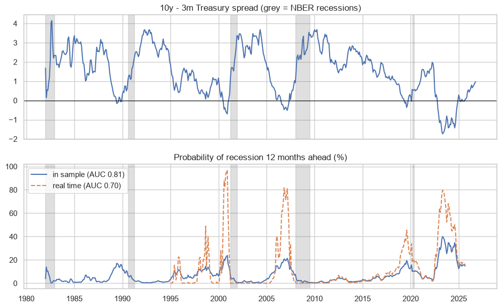

# US recession probability from the yield curve

Probit model of the probability that the US is in recession in 12 months with the 10y-3m spread (like the New York Fed model), evaluated in sample and in real time. I also compare household and market inflation expectations.

## Data
FRED: T10Y3M, USREC, SAHMREALTIME, MICH, T5YIE, CPIAUCSL, FEDFUNDS, UNRATE.

## Main results
- Spread today around +1 point, probability of recession in 12 months around 7%.
- AUC 0.81 in sample but 0.70 in real time, because of the long inversion of 2022-2024 without recession.
- The Sahm rule does not help 12 months ahead.
- Markets (5y breakeven) predict inflation a little better than households (RMSE 1.86 vs 1.94), both better than the naive forecast.



## How to run

```
pip install -r requirements.txt
jupyter notebook us_recession_probability.ipynb
```

---
Alejandro Lezcano Osorio | Universidad EIA (Colombia) and Rennes School of Business (France)
